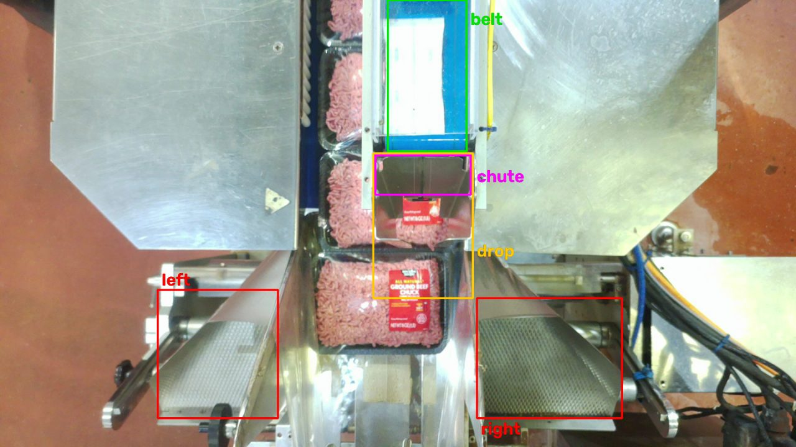

# How it works

The camera is fixed, so each part of the process always happens in the same box of the image. The
check measures a few pixel fractions in those boxes on every frame and reads events off the curves.
There is no learned model and no GPU.

| Box | What it measures |
|---|---|
| **belt** (935,0)-(1125,365) | White fraction: a sachet riding the blue belt |
| **drop** (900,370)-(1140,720) | Meat fraction and motion: a tray set passing under the chute |
| **chute** (905,375)-(1135,470) | New-white fraction: a sachet falling through the slot |
| **left / right** conveyors | New-white fraction: a sachet that missed the bag and landed beside it |

"White" means saturation < 50 and brightness > 190 in HSV. "Meat" means a red hue with saturation > 70.
"New white" means white AND more than 30 grey levels different from a slow running background. That
way the steel, the conveyors and the bag film do not count, but an object that arrives and stays does.

## 1. Sachet drops

The belt-white curve rises while a sachet rides into the belt box, then falls sharply when it drops.
A **drop** is a fall of more than 0.15 within 0.3 s, at the bottom of the fall. Falls less than 1 s
apart count as one drop.

**Sachet size** is the top-5 median of belt-white over the 1.5 s before the drop. A single sachet is
about 0.38 of the box (99th percentile 0.55). A **double strip** (two sachets still joined because the
cutter missed) is 0.66 to 0.74. A drop is a double strip when its size is at least 0.60 **and** at least
1.5 times the median of the last 40 drops.

## 2. Tray sets

A **stretch** is a run of frames where the drop box holds meat (> 2%) **and** is moving (> 6% of pixels
changed, smoothed over 0.5 s). Gaps of 0.3 s or less are merged, and stretches shorter than 0.5 s are
ignored. The motion condition matters: during a line stop a tray parked under the chute is not a new set.

**Line stops.** When the line stops with a set under the chute, the motion stops but the meat stays. When
the line restarts, the same set moves on. So a new run of motion that starts while the drop box has held
meat ever since the last stretch stopped moving **continues that stretch** (`paused_s` records the stop).
Only the drop box emptying (no meat for 0.3 s) ends it, or 120 s without moving. Before this rule, the
restart was counted as a new set with no sachet: most false `MISSING` were this.

One set takes about 2.05 s of movement to pass. When the line runs fast, sets come back to back and form
one longer stretch. The number of sets in a stretch is

    sets = 1 + round((moving time - 2.05 s) / cycle time)

where the cycle time is the median gap between drops over the last 30 s, clipped to 2 to 4 s.

**Trays moved by hand.** During a stop a worker may put trays under the chute by hand (on 11-09 at
16:10 one built a set tray by tray). Each tray placed is a full-length stretch with no sachet, so it read
`MISSING`. The **reach** box (380,380)-(900,800), beside the chute, measures the largest white blob each
frame: the worker's white sleeve. A stretch that got no sachet while that blob covered more than 25% of
the box is `by_hand`: not a set passing, not counted, `warn` instead of `alarm`. Normal sets reach at most
0.17 (bag film, labels); a sleeve reaching in is 0.33 to 0.71. A stretch that did get a sachet is judged
as usual, hand or not, and a short blip stays a `fragment`.

On FPL's hand-counted 15 min (11-09 16:00-16:15 UTC, recorder segments from the Grind box), the engine
before this rule gives 2 `MISSING` (16:10:13.9 and 16:10:16.0, both inside the 16:09:36-16:10:57 stop);
with it, 0 `MISSING` and 2 `by_hand`. The 103 `ok` sets and 3 fragments are unchanged. The sets that got
a sachet reach at most 0.18 in the reach box, so the 0.25 cut-off has a modest margin, checked on this
window only.

**Sachets added by hand.** When the dispenser is stopped, workers put sachets on the trays by hand. Those
never fall off the belt, so the set read `MISSING`. So when **nothing fell from the belt** onto a stretch,
the check looks for sachets riding into the bag on its trays, in the **tray** box (700,380)-(1220,1060),
from the stretch start to 0.5 s after it ends (`tray.py`). Each frame it lists the white blobs there; it
links them frame to frame into tracks that move down with the trays (≤ 30 px sideways, 8 to 140 px down
per frame, similar size). A track is a sachet when it lasts at least 3 frames, moves down at least 60 px
overall, and has one of the two shapes seen on grind-04:

- **slab**, lying flat on the meat: 6k to 32k px, aspect 1.1 to 4.5, at least 50% rectangular, and meat
  around it (at least 6% of a 15 px ring);
- **strip**, tucked at the seam between two trays, partly under the next one: at least 1.4 times wider
  than tall, at most 120 px tall, 3k to 20k px, in at least 60% of its frames.

Moving down is what rejects the steel right of the chute (white in 5 Nov's lighting, with meat next to
it) and labels; the shape rules reject bag film glare, which moves with the trays but is tall and has no
meat around it. One track per set seen gives `hand_added`; fewer stays `MISSING` with the shortfall.

On the 11-10 export (15:58-16:24 UTC, 26 min, a dispenser stop) the check gave 94 `MISSING`. By eye, 70 of
those sets had a sachet added by hand, flat on top or tucked at a seam; 24 had none (21 in a row at the
start, plus 3 later; confirmed by FPL). With this rule: 70 `hand_added`, 24 `MISSING`, no real miss
cleared. On 5 Nov (60 min, dispenser running) it changes nothing: every set there had a belt drop, and
the 48:13 likely real miss stays `MISSING`. There the tracks it finds, checked by eye on about 100 sets,
were all real sachets (dispenser sachets that landed on top of the trays). Not yet tested on a second day
with a dispenser stop.

**Fragments.** A stretch that moved for less than half a set's time (about 1 s) and got no sachet is a
`fragment`, not a set: a tray nudged, handled or only partly seen. It is reported with `sets: 0` and no
alert. A short stretch that did get a sachet still counts as a set, because a sachet fell onto a tray.

The drops that fall between the stretch start + 0.15 s and its end + 0.3 s belong to it. Comparing the
two counts gives `ok`, `MISSING` (fewer drops) or `EXTRA` (more drops). A double strip on an `ok` or
`EXTRA` stretch gives `DOUBLE`. A drop that belongs to no stretch fell with no tray under it (`no_tray`).

## 3. Landing: did the sachet end up in the bag?

The bag itself cannot be seen: a sachet that lands correctly slides down beside the trays and
disappears into it. So the check proves the sachet went through and that nothing ended up anywhere
else:

- **Passed the chute slot.** The new-white fraction in the slot spikes above 0.30 between 0.3 s before
  and 0.9 s after the drop.
- **OUTSIDE BAG.** A new white object appears on a side conveyor within 3 s of the drop, stays at least
  1 s, **and** is shaped like a sachet. That means 8k to 35k px, at least 72% rectangular, aspect ratio
  1.1 to 2.5, and not touching the box edge. The shape rule is what rejects bag film, exposure changes,
  arms, sleeves and hard hats; on 29 Oct it threw out 76 such alarms.
- **STUCK IN CHUTE.** The slot stays occupied for 1.5 s or more after a drop that had a tray. If the
  *next* drop happens before the slot clears, the hanging sachet was the next one, and it then fell: that
  next sachet is marked `hung_in_chute_before_falling` and this one is `IN BAG`.
- Otherwise the verdict is `IN BAG`. If the sachet passed but had no tray under it, the verdict is
  `EMPTY BAG`. If it never passed the slot, the verdict is `NOT SEEN`.

## Streaming vs batch

The method was built as a batch prototype over whole recordings (`research/prototype/`). The package
runs the same steps online and sends each result as soon as no later frame can change it. Two places
in the batch version looked into the future. The streaming version uses only the past:

| | Batch prototype | Streaming (this package) |
|---|---|---|
| Cycle time for the set count | Drops within ±30 s | Drops in the last 30 s, up to the end of the stretch |
| Typical sachet size for double strips | 20 drops each side | Last 40 drops |

The validation below compares the two **before** the line-stop and fragment rules were added (the batch
prototype has neither). What those rules changed is in the next section.

`tools/compare_with_batch.py` replays the saved signals of all four recordings through the streaming
checker and compares the results with the batch output:

| Recording | Drops | Stretches | No-tray drops | Landing verdicts | Stretch status differences |
|---|---|---|---|---|---|
| 29 Oct rec1 (60 min) | 854 = | 729 = | 9 = | 854 = | none |
| 29 Oct rec2 (60 min) | 791 = | 720 = | 5 = | 791 = | none |
| 29 Oct rec3 (54 min) | 780 = | 516 = | 3 = | 780 = | 1: a batch false `EXTRA` is now `ok` |
| 5 Nov 4313d69a (60 min) | 762 = | 496 = | 7 = | 762 = | 4 (below) |

The 4 differences on 5 Nov are all borderline cases:

- **Set count on long stretches (9 s, 4 s and 9 s).** The streaming cycle time differs by 0.3 to 0.8 s,
  so the estimated set count moves by one. Two `ok` stretches become false `EXTRA`, and one batch false
  `EXTRA` becomes `ok`.
- **The 59:30 drop (size 0.64).** It was only just over the line in batch, because it came near the end
  of the recording where the window was one-sided. Streaming does not flag it as a double.

Running the whole package on the 5 Nov video gives exactly the same results as the replay. Here
`sachet run` decoded the video and computed the signals itself, so this run checks the signal code too.
It took 7 min 53 s for the 60 min recording on a laptop (about 7.6× real time).

## Line-stop and fragment rules (after the 11-09 hand count)

FPL's hand count of 15 min on 11-09 (118 sets) found 0 of 8 `MISSING` real: all were stretches of
0.5 to 1.6 s, around line stops, while a set takes about 2 s. Replaying our four recordings with the two
rules above:

| Recording | `MISSING` before | after | Changed into |
|---|---|---|---|
| 29 Oct rec1 | 4 | 2 | 2 restarts joined to their set (now `ok`); 1 joined but still `MISSING` (34:40) |
| 29 Oct rec2 | 0 | 0 | |
| 29 Oct rec3 | 3 | 0 | 2 restarts joined (now `ok`), 1 fragment (0.5 s) |
| 5 Nov 4313d69a | 7 | 2 | 1 restart joined (now `ok`); 3 joined into two stretches still `MISSING` (27:05, 48:13); 2 fragments (0.6 and 0.7 s) |

Every drop, no-tray drop and landing verdict is unchanged, and so are the fault clip (`MISSING` at
63.7 s) and the missed-bag clip (2 `OUTSIDE BAG`, 1 `STUCK IN CHUTE`). Of the 4 `MISSING` left:

- **rec1 34:40:** joined across a stop, 2 sets and 1 sachet. The video shows the dispenser stopped with a
  sachet left on the belt while the second tray moved out, so it looks real.
- **5 Nov 48:13:** the likely real miss. Still `MISSING`.
- **5 Nov 27:05:** a long stop/restart, 3 sets and 1 sachet. Not checked by eye.
- **rec1 32:34:** a full-length (2.7 s) stretch with no sachet, alone in a long pause. Not touched by
  either rule. Not checked by eye.

## Results so far

- **29 Oct (2.9 h, ~2,413 sets):** no confirmed set without a sachet; 4 double strips; 0 sachets outside the bag.
- **5 Nov recording 4313d69a (1 h, ~757 sets):** one likely real miss at 48:13. A set slid into its bag
  with no drop, and the sachets then came in a burst into the next empty bags. This needs confirmation
  from the line.
- **Synthetic test** (a real sachet pasted onto each side conveyor and into the chute): 3 of 3 caught.
- **Fault clip** (sachet held on the belt): the set is flagged `MISSING`.

## Known weak points

- **Hand-added sachets** are seen only when some of the sachet shows as it rides down: flat on top or
  tucked at a seam. One pushed fully under or between trays is not seen, and that set reads `MISSING`.
  The rule was tuned on one 26 min export; it has not yet been checked on a second dispenser stop.
- **A worker's white sleeve** moving down past the trays could be tracked like a sachet and turn a real
  miss into `hand_added`. Not seen on 11-10 (0 of 24 real misses cleared), but the 11-09 stop where a
  worker built a set by hand was not available to test.

- **Set count on long stretches.** This is the main source of false `EXTRA`: about 5 per hour on
  5 Nov.
- **Set count across a stop.** A set that crawls during a slow stop/restart has more moving time than
  2.05 s, so a joined stretch can be counted as one set too many.
- **Occlusion.** An operator's hard hat or bag film over the belt box can look like a drop with no tray.
  This gives a false `EMPTY BAG` (5 of the 9 on 29 Oct rec1).
- **Two sachets stacked exactly on top of each other** look like one.
- **Hands at the chute.** An operator clearing a jam by hand can produce drops and alerts that are real
  events but not machine faults. The other way round, a set that really got no sachet while a worker's
  sleeve was beside the chute reads `by_hand` (`warn`), not `MISSING`. The sleeve check needs a white
  sleeve: a bare or dark-sleeved arm is not seen.
- **OUTSIDE BAG** has only been proven on the synthetic test. No real missed-bag case exists in the
  footage so far.
- **Camera movement.** The boxes are fixed pixels. A camera bump of more than ~15 px needs new boxes
  ([calibration.md](calibration.md)).
